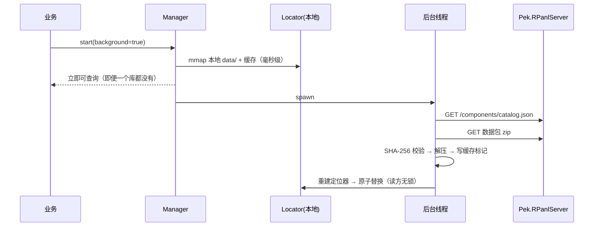

# Pek.ZIP

`Pek.ZIP` 是 Pek 生态 IP 归属地库的 **Zig** 实现（crate/module `pek_zip`），对标：

- Rust [`Pek.IP`](../Rust/Pek.IP)（`xdb v3` + MaxMind MMDB + 双源合并 + 按需下载）；
- C# [`DH.NIP`](../../Pek.FrameWork/DH.NIP)（NewLife.IP：纯真 `ip.gz` + 在线 API + DB-IP CSV 转换）。

Zig **0.17.1**（本机实测版本；`build.zig.zon` 的最低版本仍为 0.17.0），**零第三方依赖**（全部 std：`Io`/`File.createMemoryMap`/`compress.flate`/`zip`/`json`/`http`）。

## 特性

| 能力 | 说明 |
|------|------|
| 国内 | ip2region **xdb v3**（IPv4/IPv6，Vector/BTree 索引，省/市/运营商） |
| 国外 | **MMDB**（GeoLite2 / GeoIP2 / DB-IP；City/Country/ASN/ISP；24/28/32 位记录） |
| 兼容 | **纯真 QQWry**（`ip.gz`，GBK→UTF-8，`std.compress.flate` 直接解压） |
| 特殊地址 | 内网/回环/链路本地/组播/文档/基准/保留/NAT64/ORCHID —— 查库前短路 |
| 合并 | 国内省市以 xdb 为准，经纬度/时区/区县由 MMDB 补齐；ASN 兜底 ISP |
| 启动异步 | 本地数据**毫秒级**就绪，缺的由后台线程从 **Pek.RPanlServer** 组件源下载后**原子热替换** |
| 性能 | mmap 只读 + 零分配查询 + 无锁共享（见下方实测） |

## 快速开始

```zig
const pek = @import("pek_zip");

// 1) 启动时异步：本地有就立即用，缺的后台下载（推荐）
var manager = try pek.Manager.start(io, gpa, ".", .{ .background = true });
defer manager.destroy();

var scratch: pek.Scratch = .{};
const loc = try manager.lookupStr(&scratch, "114.114.114.114");
var buf: [128]u8 = undefined;
std.debug.print("{s}（{s}）\n", .{ loc.displayShort(&buf), loc.source.label() });
```

```zig
// 2) 手动组装（数据文件自己管）
var locator = pek.Locator{};
defer locator.deinit();
locator.xdb_v4 = try pek.XdbReader.open(io, gpa, "data/ip2region_v4.xdb");
locator.world  = try pek.MmdbReader.open(io, gpa, "data/dbip-city-lite.mmdb", .auto);
locator.world_asn = try pek.MmdbReader.open(io, gpa, "data/dbip-asn-lite.mmdb", .auto);
```

命令行：

```text
zpk lookup 114.114.114.114 8.8.8.8   # 查询（默认只读本地，不因网络卡住）
zpk lookup 114.114.114.114 --online  # 后台补缺并等下载结束再退出
zpk sync                             # 检查更新：本地齐全也比对目录版本，有新版本才下
zpk sync --force                     # 忽略 CatalogMaxAge 目录缓存，强制联网刷新
zpk selfcheck                        # 配置 + 数据集状态 + 样例查询
zpk mkxdb out.xdb                    # 生成最小 xdb（测试/演示）
```

## 配置（`Config/Ip.toml`，首次运行自动生成）

```toml
StoreUrl   = "https://p.sc8.fun"   # Pek.RPanlServer 平台（固定，一般不改）
PubKey     = ""                   # 平台 Ed25519 公钥；非空 = 强制验签（v0.1 未实现 → 拒绝下载）
DataDir    = "data"               # 本地数据目录（xdb/mmdb/ip.gz）
CacheDir   = "Data/IpCache"       # 下载缓存（{id}/{version}/ + .pek-zip.json）
StateDir   = "Data/IpClient"      # 客户端身份（授权流程预留）
AutoEnroll = true                 # 预留
DownloadV6 = false                # IPv6 xdb 约 37 MiB，默认不下载
CatalogMaxAge = 3600              # 组件目录缓存新鲜期（秒）；期间只读本地，0 = 每次都拉
HttpTimeoutMs = 120000            # 单次请求总超时（毫秒；0 = 不限）
# CaFile   = "Config/ca.pem"      # 内网/自签平台的自定义根证书
```

### 带宽与更新策略

- **目录不重复拉**：`catalog.json` 落到 `{CacheDir}/.catalog.json`，`CatalogMaxAge` 内直接用本地缓存
  （配了 `PubKey` 时连缓存一起验签；时钟回拨/缓存损坏一律按不新鲜处理）。
- **包只在新版本时下**：`zpk sync` 比对目录版本与本地已装版本，同版本/更低一律跳过。
- **同机只下一次**：共享 `CacheDir` 时由 `{CacheDir}/.sync.lock` 独占创建保证一个进程去下载，
  其余进程直接复用；崩溃残留超 10 分钟自动视为陈旧。
- **定时更新**：由任一个常驻进程（或计划任务）定时跑 `zpk sync` 即可，其余应用启动只读共享缓存。

### 请求超时（复用 zzig 的原生取消，不是自造看门狗）

Zig 0.17.1 的 `std.http.Client` **没有生效的超时**：`ConnectTcpOptions.timeout` 声明了但 `connectTcpOptions` 从不读取它。
但 0.17 有**原生并发取消**：`Io.concurrent(io, fn, args)` → `Future`，`Future.cancel(io)` 会请求取消并**等任务结束**。
同生态 `zzig/src/http/http.zig` 的 `fetchBytesWithTimeout` 已是这套做法（已上线），本项目直接复用该机制（仅把轮询换成
`Io.Condition.waitTimeout`，事件驱动、无空转）。

效果：超时 → 取消请求并**把线程收回来**（不泄漏线程）；实测“只 accept 不回包”的监听 + `HttpTimeoutMs=1200` → **1.25s 返回 Timeout**。

数据文件命名（不区分大小写，与 Pek.IP 一致）：

- IPv4：`data/ip2region_v4.xdb`（兼容 `ip2region.xdb`）
- IPv6：`data/ip2region_v6.xdb`
- 城市/国家：`data/*.mmdb` 且名称含 `city` / `country`
- ASN/ISP：`data/*.mmdb` 且名称含 `asn` / `isp`
- 纯真：`data/ip.gz`（`qqwry.dat` / `ip.dat` 也认）

## 启动时异步：时序



- **读方不取锁**：`acquire` 一次原子加 + 指针复核；旧定位器进「退休列表」，运行期不销毁（廉价 hazard pointer 替代），退出时统一回收。
- **失败不降级**：下载/校验失败只记 `lastError()`，旧数据继续服务；`zpk sync` 返回码 1。
- **为什么是线程**：Zig 0.17 在 Windows 上 socket 读仍是同步 `deviceIoControl`，真异步需自建 AFD/IOCP；放独立线程是当前平台唯一能「启动不等网络」的做法（POSIX 可换 `Io.concurrent`，接口不变）。

## 性能（实测，ReleaseFast，本机 2026-11-18）

数据：`ip2region_v4.xdb`（11 MiB）+ `dbip-country-lite-2026-10.mmdb`（8 MiB，IPv6 树）+ `dbip-asn-lite`，20 万次/项：

| 场景 | ns/op | QPS |
|------|-------|-----|
| xdb（ip2region v4） | 66 | 15,162,657 |
| MMDB（国外库） | 1,547 | 646,469 |
| 合并 lookup | 1,930 | 518,153 |
| 保留地址短路 | 9.1 | 110,472,824 |
| 4 线程并发 lookup | 487 | 2,051,787 |

复现：`zig build bench -- 'G:/Code/Rust/Pek.IP/data' 200000`（库模块同样 ReleaseFast）。

设计要点：mmap 只读（v6 库 37 MiB 不进进程私有内存，多进程共享页缓存）、查询零分配（切片借用映射内存）、标签/国家名走编译期静态表二分。

## 数据与许可

| 数据 | 用途 | 许可 |
|------|------|------|
| `ip2region_v4.xdb` / `ip2region_v6.xdb` | 国内城市级 | Apache-2.0（ip2region） |
| `dbip-country-lite-*.mmdb` / `dbip-asn-lite-*.mmdb` / `dbip-city-lite-*.mmdb` | 国外 | CC BY 4.0（db-ip.com） |
| `GeoLite2-*.mmdb` | 国外 | MaxMind EULA（需账号） |
| `ip.gz`（纯真） | 兼容旧数据 | 纯真网络（自备） |

**数据文件不入库**（`.gitignore`）：由使用方按各自许可获取，或上传到 Pek.RPanlServer 组件源（分类 `ip-database`）。

## 与两个参考项目的差异（v0.1）

| 项 | Pek.IP | Pek.ZIP |
|----|--------|---------|
| 语言/依赖 | Rust + `maxminddb` + `dhrust` | Zig 0.17 + 纯 std |
| 查询分配 | 返回 `String` | **零分配**（切片借用 mmap） |
| 文件加载 | 全量读入内存 | **mmap 只读**（可 `no_mmap` 退化） |
| 纯真 QQWry | 不支持 | **支持**（GBK 解码 + gzip） |
| 在线 API | 不支持 | 解析逻辑待接（DH.NIP 的 4 种格式已调研，v0.2） |
| 下载授权 | Ed25519 自动注册 + 票据 | **未实现**（配 `PubKey` 时明确拒绝下载，不静默放行） |
| 请求超时 | 60 s | **未设置**（std 0.17 `Client` 未暴露 per-request 超时；下载在后台线程，不影响查询） |
| DB-IP CSV 转换 | 无 | 待接（`gb2312.Encoder` 已就绪） |

## 文档

- 接续与决策：`docs/项目接续指南.md`、`docs/决策记录.md`
- 一键回归：`tools/regression.ps1`（构建 → 单测 → CLI 自检 → 真实数据）
